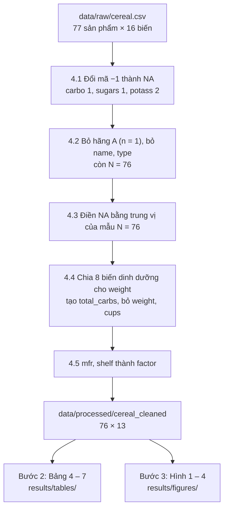

# cereal-rating: phân tích điểm đánh giá ngũ cốc ăn sáng

Bài tập lớn môn MT2013 *Xác suất thống kê*, ĐH Bách Khoa – ĐHQG-HCM. Nhóm L16 – XVIII, HK261,
GVHD TS. Hồ Tuấn Đức.
Đề tài: phân tích mức độ ảnh hưởng của các thành phần dinh dưỡng và nhà sản xuất đến điểm đánh giá
(rating) của ngũ cốc ăn sáng, trên 77 sản phẩm bán tại Mỹ. Biến phụ thuộc là `rating`; biến giải thích
là 8 thành phần dinh dưỡng, hàm lượng vitamin, nhà sản xuất (`mfr`) và vị trí kệ (`shelf`).

- Dữ liệu: *80 Cereals*, Kaggle, <https://www.kaggle.com/datasets/crawford/80-cereals>
- Ngôn ngữ: R

Quy trình gồm ba phần:

1. **Tiền xử lý** (Phần 4 báo cáo). Đổi mã khuyết −1 thành NA, bỏ hãng A vì chỉ có 1 sản phẩm (còn
   N = 76), điền khuyết bằng trung vị, chia 8 biến dinh dưỡng cho `weight` để đưa về khẩu phần 1 oz,
   tạo biến `total_carbs = carbo + sugars`.
2. **Thống kê mô tả** (Phần 5). Bảng tần số, các đặc trưng mẫu, ngoại lai theo hàng rào Tukey, rating
   theo từng nhóm; histogram + KDE, boxplot, ma trận tương quan và biểu đồ phân tán.
3. **Thống kê suy diễn** (chưa làm). So sánh rating giữa các hãng và các kệ (ANOVA hoặc
   Kruskal-Wallis), kiểm định tương quan, hồi quy tuyến tính bội OLS. Xem mục
   [Phần còn lại](#phần-còn-lại).

## Cài đặt

R 4.1 trở lên (phát triển trên R 4.6.1), nên dùng thêm RStudio.

1. Mở file `cereal-rating.Rproj` bằng RStudio. RStudio sẽ tự đặt thư mục làm việc về thư mục gốc
   dự án; mọi đường dẫn trong code đều tính từ đây.
2. Cài thư viện (chỉ cần một lần):

   ```r
   source("install_packages.R")
   ```

Dự án dùng 6 thư viện: `dplyr`, `tidyr`, `e1071` (skewness), `ggplot2`, `ggcorrplot`, `patchwork`.

Không dùng RStudio thì chạy `Rscript` từ thư mục gốc. Trên Windows, nếu `Rscript` chưa có trong PATH
thì gọi bằng đường dẫn đầy đủ, ví dụ:

```powershell
& "C:\Program Files\R\R-4.6.1\bin\Rscript.exe" run_all.R
```

## Dữ liệu

`data/raw/cereal.csv` có 77 dòng và 16 biến. File này là dữ liệu gốc, không sửa tay; mọi thay đổi
đều làm bằng code ở bước 1.

| Biến | Ý nghĩa | Đơn vị |
|---|---|---|
| `name` | Tên sản phẩm | – |
| `mfr` | Nhà sản xuất: A, G, K, N, P, Q, R | – |
| `type` | C: ăn lạnh (74 sản phẩm), H: ăn nóng (3 sản phẩm) | – |
| `calories` | Năng lượng | kcal |
| `protein`, `fat`, `fiber`, `carbo`, `sugars` | Đạm, chất béo, chất xơ, tinh bột, đường | g |
| `sodium`, `potass` | Natri, kali | mg |
| `vitamins` | Vitamin và khoáng chất, % nhu cầu khuyến nghị mỗi ngày (0, 25 hoặc 100) | % |
| `shelf` | Vị trí kệ trưng bày: 1 thấp, 2 vừa, 3 cao | – |
| `weight` | Khối lượng một khẩu phần (0,5 – 1,5) | oz |
| `cups` | Thể tích một khẩu phần | cup |
| `rating` | Điểm đánh giá (18,04 – 93,70) | điểm |

Mã nhà sản xuất: A = American Home Food Products, G = General Mills, K = Kelloggs, N = Nabisco,
P = Post, Q = Quaker Oats, R = Ralston Purina.

Các biến dinh dưỡng tính trên một khẩu phần. Dữ liệu không có ô trống, nhưng có 4 giá trị khuyết ghi
bằng −1: `carbo` và `sugars` của Quaker Oatmeal, `potass` của Almond Delight và Cream of Wheat
(Quick).

## Chạy toàn bộ

Trong RStudio:

```r
source("run_all.R")
```

Hoặc từ terminal, tại thư mục gốc:

```powershell
Rscript run_all.R
```

Toàn bộ mất khoảng 20 giây. Có thể chạy riêng từng bước:

| Bước | Lệnh | Việc làm | Mục trong báo cáo | Đầu ra |
|---|---|---|---|---|
| 0 | `Rscript install_packages.R` | Cài các thư viện còn thiếu | – | – |
| 1 | `Rscript analysis/01_preprocess.R` | Tiền xử lý số liệu | Phần 4 | `data/processed/cereal_cleaned.csv`, `.rds` |
| 2 | `Rscript analysis/02_descriptive_stats.R` | Bảng 4 – 7; đường theo kệ; Pearson / Spearman | Mục 5.1, Bảng 7 – 9 | `results/tables/bang_*.csv` |
| 3 | `Rscript analysis/03_descriptive_plots.R` | Hình 1 – 4, ma trận tương quan | Mục 5.2 | `results/figures/Hinh_*.png` |

Bước 2 và 3 đọc dữ liệu sạch do bước 1 lưu, nên phải chạy bước 1 trước; bước 2 và 3 không phụ thuộc
nhau. Mỗi bước tự nạp thư viện và hàm cần dùng, nên mở riêng một file trong `analysis/` rồi bấm
*Source* cũng chạy được.

Khi chạy trong RStudio, các hình hiện ở khung *Plots*. Khi chạy bằng `Rscript`, hình chỉ được lưu ra
file PNG.

Kiểm tra dữ liệu sau tiền xử lý (10 kiểm tra: số dòng, số cột, không còn NA, đã chia `weight`,
điền đúng trung vị...):

```powershell
Rscript tests/test_preprocess.R
```

### Sơ đồ quy trình



### 1. Tiền xử lý

Hãng A chỉ có một sản phẩm (Maypo) nên không tính được phương sai trong nhóm khi chạy ANOVA; quan
trắc này bị loại trước tiên, để trung vị dùng điền khuyết được tính trên đúng mẫu phân tích N = 76.
Biến `name` chỉ để định danh, còn `type` có 3/77 sản phẩm ăn nóng, quá ít để so sánh nhóm, nên cả hai
bị bỏ khỏi dữ liệu phân tích. Tên sản phẩm vẫn được giữ làm tên dòng để tra ngoại lai ở Bảng 6.

Khối lượng khẩu phần chênh nhau tới 3 lần (0,5 – 1,5 oz), nên 8 biến dinh dưỡng được chia cho `weight`
để so sánh trên cùng 1 oz. `rating` và `vitamins` giữ nguyên. Biến `total_carbs` chỉ dùng cho thống
kê mô tả; không đưa `carbo`, `sugars` và `total_carbs` cùng lúc vào mô hình hồi quy vì sẽ đa cộng
tuyến hoàn hảo.

Dữ liệu sạch được lưu hai dạng: `cereal_cleaned.csv` (76 dòng × 13 cột, để xem và nộp kèm báo cáo) và
`cereal_cleaned.rds` (cùng nội dung, giữ kiểu factor và tên sản phẩm; bước 2 và 3 đọc file này).

### 2. Kết quả chính (Phần 5)

Tương quan Pearson của `rating` với từng biến, N = 76:

| Biến | r | Biến | r |
|---|---|---|---|
| `sugars` | −0,765 | `fiber` | 0,660 |
| `calories` | −0,648 | `protein` | 0,574 |
| `total_carbs` | −0,585 | `potass` | 0,524 |
| `fat` | −0,397 | `carbo` | 0,255 |
| `sodium` | −0,360 | `vitamins` | −0,240 |

- `rating` có trung bình 42,51, trung vị 40,25, lệch phải (skewness 0,94). Chỉ có một ngoại lai là
  All-Bran with Extra Fiber (93,70 điểm).
- Theo hãng, Nabisco có rating trung bình cao nhất (67,97; n = 6), General Mills thấp nhất (34,49;
  n = 22). Theo kệ, kệ 2 thấp nhất (33,98) so với kệ 1 (46,15) và kệ 3 (45,22).
- `fiber` và `potass` tương quan rất mạnh với nhau (r = 0,923), `total_carbs` tương quan mạnh với
  `fiber` (−0,838) và `potass` (−0,804). Cần kiểm tra VIF trước khi chốt mô hình hồi quy.

Các chênh lệch trên mới là thống kê mô tả, chưa qua kiểm định.

## Tái lập

Quy trình không có bước ngẫu nhiên, nên chạy lại luôn cho đúng cùng số liệu. Các số liệu khớp với
script gốc `archive/Báo cáo tới 5.r`; khác biệt duy nhất là nhãn kệ nay có dấu ("Kệ 1 (Thấp)") và hình
không còn in tiêu đề "Hình x" bên trong ảnh (chú thích nằm trong báo cáo LaTeX). Hình PNG có thể khác
đôi chút về font giữa các máy.

## Báo cáo LaTeX

Mã nguồn báo cáo (tới Phần 5) ở `report/latex/main.tex`, đã sửa theo `doc/NHAN_XET_BAO_CAO.md`. Hình
được lấy trực tiếp từ `results/figures/`, nên chạy `run_all.R` trước. Biên dịch bằng XeLaTeX (font
Times New Roman), chạy hai lần để có mục lục:

```powershell
cd report/latex; xelatex main.tex; xelatex main.tex
```

Muốn có logo trên bìa thì đặt file `logo_bk.png` vào `report/latex/`.

## Cấu trúc thư mục

```text
BTL/
├── README.md
├── cereal-rating.Rproj          # mở bằng RStudio, tự đặt thư mục làm việc về đây
├── install_packages.R           # cài thư viện còn thiếu
├── run_all.R                    # chạy bước 1 → 3
├── data/
│   ├── raw/
│   │   └── cereal.csv           # dữ liệu gốc, không sửa tay
│   └── processed/               # sinh tự động ở bước 1
│       ├── cereal_cleaned.csv   #   76 × 13, để xem / nộp kèm báo cáo
│       └── cereal_cleaned.rds   #   cùng dữ liệu, giữ kiểu factor và tên sản phẩm
├── src/                         # hàm dùng chung, không tự chạy
│   ├── config.R                 # thư viện, đường dẫn, danh sách biến, hằng số
│   ├── preprocess.R             # Phần 4: mỗi hàm ứng với một mục 4.1 – 4.5
│   ├── descriptive.R            # Mục 5.1: tần số, đặc trưng mẫu, ngoại lai Tukey, theo nhóm
│   └── plots.R                  # Mục 5.2: hàm vẽ Hình 1 – 4
├── analysis/                    # các bước chạy, trao đổi với nhau qua file
│   ├── 01_preprocess.R          # bước 1
│   ├── 02_descriptive_stats.R   # bước 2
│   └── 03_descriptive_plots.R   # bước 3
├── tests/
│   └── test_preprocess.R        # kiểm tra dữ liệu sau tiền xử lý
├── results/                     # sinh tự động
│   ├── tables/                  #   Bảng 4 – 7, ma trận tương quan (.csv)
│   └── figures/                 #   Hình 1 – 4 (.png, 300 dpi)
├── report/
│   ├── L16_NHÓM XVIII.pdf       # bản báo cáo cũ (tới Phần 5)
│   └── latex/main.tex           # báo cáo viết lại bằng LaTeX → main.pdf
├── doc/
│   └── NHAN_XET_BAO_CAO.md      # các lỗi tìm thấy trong báo cáo, cần sửa
└── archive/
    └── Báo cáo tới 5.r          # script gốc một file, chỉ giữ để đối chiếu
```

Nếu đưa lên GitHub, `.gitignore` bỏ qua `data/processed/` và `results/` vì chạy lại `run_all.R` là
có.

## Phần còn lại

Theo mục tiêu ở Phần 2.2 của báo cáo, các bước tiếp theo dự kiến như sau:

| Bước | File dự kiến | Nội dung |
|---|---|---|
| 4 | `analysis/04_compare_groups.R` | Shapiro-Wilk và Levene theo nhóm; ANOVA + Tukey HSD, hoặc Kruskal-Wallis + Dunn, cho `rating` theo `mfr` và `shelf` |
| 5 | `analysis/05_correlation.R` | Kiểm định ý nghĩa hệ số Pearson / Spearman; VIF |
| 6 | `analysis/06_regression.R` | Hồi quy OLS; kiểm định t, F, R²; chẩn đoán phần dư (Breusch-Pagan, Shapiro-Wilk, Durbin-Watson, Cook) |

Khi thêm một bước mới:

- Hàm đặt trong `src/` (ví dụ `src/inference.R`), script chạy đặt trong `analysis/` và đánh số tiếp.
- Tham số và danh sách biến khai báo trong `src/config.R`, không viết cứng đường dẫn trong code.
- Lưu bảng bằng `save_table()` và hình bằng `save_figure()` để kết quả nằm đúng `results/`.
- Thêm thư viện mới (ví dụ `car` cho Levene và VIF, `lmtest` cho Breusch-Pagan và Durbin-Watson) vào
  cả `install_packages.R` và `src/config.R`, rồi thêm script vào danh sách trong `run_all.R`.

## Trích dẫn dữ liệu

Chris Crawford. *80 Cereals: Nutrition data on 80 cereal products*. Kaggle.
<https://www.kaggle.com/datasets/crawford/80-cereals>
